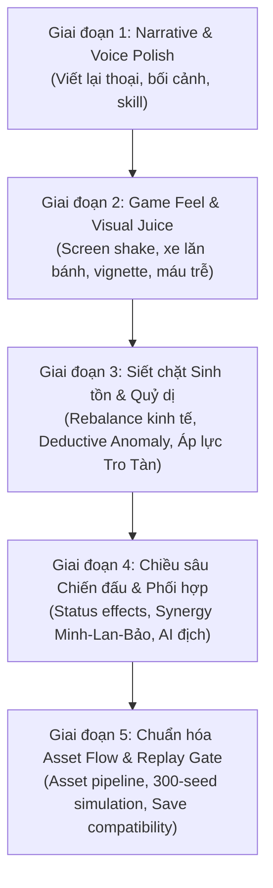

# KẾ HOẠCH NÂNG CẤP TOÀN DIỆN LAST CONVOY (PHIÊN BẢN R2)
*Chuyển dịch từ "Bảng điều khiển quản lý số học" sang "Trải nghiệm sinh tồn chiến thuật quỷ dị điện ảnh"*

**Ngày tạo:** 2026-10-28  
**Trạng thái:** Đang triển khai (In Progress)  
**Tác giả:** Antigravity AI & Nhóm phát triển  

---

## I. MỤC TIÊU VÀ ĐỊNH VỊ CỦA ĐỢT NÂNG CẤP R2

Sau khi đánh giá toàn bộ tài liệu kiến trúc, mã nguồn thực tế và kết quả mô phỏng (2.400 lượt chạy với tỷ lệ thắng 100% ở mọi chiến thuật thông thường), vấn đề cốt lõi của **LAST CONVOY** đã được xác định:
> **Kiến trúc engine rất xuất sắc (deterministic, atomic commands, domain events, facts/knowledge), nhưng toàn bộ sự hấp dẫn bị chôn vùi dưới dạng số liệu tĩnh và quy trình máy móc (auto-pilot).**

Đợt nâng cấp R2 nhằm giải quyết dứt điểm 4 trụ cột:
1. **Trải nghiệm chơi & Cảm xúc (Gameplay & Balance)**: Tạo áp lực sinh tồn nghẹt thở, biến quy tắc quỷ dị thành bài kiểm tra suy luận thật, biến cuộc đua với Tro Tàn thành sức ép trực quan, và thêm chiều sâu phối hợp (synergy) cho Combat.
2. **Visual Juice & Game Feel (Cảm giác tương tác)**: Đánh thức 29 tác phẩm mỹ thuật A2 sẵn có bằng hiệu ứng rung giật (screen shake), đòn đánh nảy số, thanh máu tụt trễ, xe lăn bánh mượt mà trên bản đồ và sương mù quỷ dị.
3. **Văn phong & Không khí (Narrative & Voice Polish)**: Viết lại toàn bộ văn bản trong game, xóa bỏ lối hành văn dịch thô / cứng nhắc (word-by-word) kiểu cẩm nang kỹ thuật; thổi hồn chất văn học hậu tận thế tàn khốc, giàu chi tiết giác quan và đậm bản sắc nhân vật.
4. **Chuẩn hóa Flow tạo Assets**: Quy chuẩn hóa quy trình sản xuất, tối ưu hóa asset 2D tĩnh bằng shader/filter CSS thay vì vẽ thừa thãi.

---

## II. LỘ TRÌNH 5 GIAI ĐOẠN TRIỂN KHAI CHI TIẾT

---

### GIAI ĐOẠN 1: NARRATIVE & VOICE POLISH (VIẾT LẠI VĂN PHONG)
*Mục tiêu: Xóa bỏ cảm giác đọc tài liệu kỹ thuật, biến mỗi câu chữ thành một nhát cắt lạnh lẽo của thế giới hậu tận thế.*

#### 1. Nguyên tắc định hình giọng văn (Tone & Voice Bible)
* **Phong cách chung**: *Grimdark Supernatural Apocalypse* (Tàn khốc, hoang tàn, u tối, ngột ngạt nhưng lẩn khuất hy vọng sinh tồn).
* **Đặc tính ngôn ngữ**:
  * Dùng động từ mạnh, tính từ chỉ xúc giác, thị giác và khứu giác (mùi kim loại rỉ sét, tiếng sắt cào trên mặt đường nứt, ánh đèn vàng vọt lờ mờ, hơi sương lạnh ngấm vào phổi).
  * Tránh lối dịch nguyên ngữ máy móc tiếng Anh (ví dụ: *"Tấn công mạnh, phá vỡ phòng thủ đối phương"* $\rightarrow$ *"Minh dộng búa tạ xé toạc khớp giáp đối phương trong tiếng kim loại gãy vụn"*).
* **Bản sắc nhân vật qua lời thoại**:
  * **Minh (Chỉ huy)**: Lạnh lùng, quyết đoán, nói ít làm nhiều, luôn mang gánh nặng trách nhiệm đè nặng lên vai.
  * **Lan (Y sĩ)**: Trầm lặng, quan sát tinh tế, lời nói nhẹ nhàng nhưng giấu nỗi đau mất mát; trực giác nhạy bén trước các hiện tượng phi tự nhiên.
  * **Bảo (Thợ máy)**: Cộc cằn, thực dụng, yêu chiếc xe như tính mạng, càu nhàu về từng giọt xăng nhưng không bao giờ bỏ rơi đồng đội.
  * **Hà (Người sống sót ở Chợ)**: Cảnh giác cao độ, ánh mắt như thú hoang bị dồn vào chân tường, giọng khàn đặc vì khát.
  * **Quạ & Tàn (Đoàn xe Tro Tàn)**: Giáo điều quái dị, cuồng tín, tôn thờ sự sụp đổ và các quy luật mới của bóng tối.

#### 2. Kế hoạch viết lại nội dung cụ thể
* **8 Địa điểm**: Viết lại phần giới thiệu (lore) tại Gara, Chợ Sơ Tán, Cầu Vượt Đứt Gãy, Bệnh Viện Thánh An, Khu Nội Trú, Trạm Dịch Vụ, Đèo Sương Mù, Vành Đai Bắc Sơn.
* **12 Sự kiện cốt truyện**: Bổ sung chi tiết đối thoại giữa các thành viên đoàn xe thay vì chỉ mô tả trạng thái khách quan.
* **4+ Kỹ năng & Kỳ vật**: Đổi tên và mô tả kỹ năng mang tính hình tượng và cảm xúc hơn:
  * *Phá Giáp* $\rightarrow$ **Khai Sơn Phá Thạch** (Búa nặng bẻ gãy phòng thủ, mở toang sơ hở).
  * *Cấp Cứu* $\rightarrow$ **Băng Bó Chiến Trường** (Chèn gạc cầm máu khẩn cấp giữa tiếng đạn réo).
  * *Linh Cảm* $\rightarrow$ **Mắt Thứ Ba / Giác Quan Quỷ Dị** (Đồng tử giãn nở, lắng nghe nhịp thở của dị tượng).
  * *Sửa Chữa* $\rightarrow$ **Hàn Gia Cố Khẩn** (Tiếng hồ quang tóe lửa hàn chết thanh giằng nứt).

---

### GIAI ĐOẠN 2: GAME FEEL & VISUAL JUICE (ĐÁNH THỨC GIAO DIỆN & ÂM THANH)
*Mục tiêu: Đưa người chơi vào "Sân khấu điện ảnh" (Scene-First) thay vì thao tác trên một trang quản trị.*

#### 1. Đòn đánh có sức nặng (Combat Juice)
* **Screen Shake**: Rung lắc khung nhìn trong 180ms – 250ms khi nhận/gây sát thương lớn (>20 HP) hoặc khi xe bị tông.
* **Hit Flash**: Chớp sáng đỏ/trắng trên card chân dung của mục tiêu bị trúng đòn (120ms).
* **Floating Combat Numbers (Số nảy)**:
  * Sát thương: Số đỏ rực nhảy vọt lên trên kèm phóng to nhẹ (`scale(1.3) -> scale(1.0)` rồi mờ dần).
  * Hồi máu: Số xanh ngọc dịu dàng trôi chậm lên trên.
  * Chắn đòn / Giảm thương: Chữ *"CHẮN"* màu vàng kim nảy nhẹ.
* **Delayed HP Drain (Thanh máu tụt trễ)**:
  * Thanh máu đỏ tụt ngay lập tức theo sát thương.
  * Một vệt máu trắng/vàng đệm phía sau giữ nguyên trong 300ms rồi mới co đuổi theo từ từ (700ms), tạo cảm giác mất mát rõ rệt như các game RPG kinh điển (*Darkest Dungeon*, *Hollow Knight*).

#### 2. Chuyển động xe lăn bánh trên Map (Smooth Travel)
* Thay vì click "Di chuyển" là xe biến mất và xuất hiện lập tức tại điểm đích:
  * **Interpolation**: Xe (sprite alpha) trượt êm dọc theo đường nối SVG giữa hai địa điểm trong 0.9 giây (sử dụng CSS `transition` hoặc SVG path interpolation).
  * **Hiệu ứng phụ trợ**: Vệt sáng đèn pha hình nón quét qua nền sương mù tối của bản đồ; tiếng gầm rú của động cơ diesel hòa quyện tiếng đá lạo xạo dưới lốp xe.

#### 3. Bầu không khí Quỷ dị (Atmospheric Shaders & Overlays)
* **Vignette Co Bóp**: Khi vào vùng ảnh hưởng quỷ dị (Bệnh Viện Thánh An) hoặc khi chuông reo:
  * Viền màn hình tối lại và nhấp nháy chậm theo nhịp tim (pulsing dark vignette).
* **Nhiễu hạt & Tàn tro (Ash / Dust Drift)**:
  * Lớp phủ CSS nhẹ với các đốm tro tàn bay lơ lửng trên nền art địa điểm tĩnh.

#### 4. Phân tầng Cấp độ Giao tranh & Âm thanh
* **Cấp 1: Cọ xát thông thường (Chợ, cướp vặt)**: Hoàn toàn không có áp lực thời gian. Thoại cộc lốc cướp bóc, âm thanh gậy gộc va chạm kim loại.
* **Cấp 2: Tranh chấp vũ trang (Đột kích kho)**: Giới hạn 6–8 hiệp rộng rãi tránh câu giờ. Tiếng súng đanh thép, tiếng vỏ đạn rớt.
* **Cấp 3: Khủng hoảng Quỷ dị & Boss (Bệnh viện Thánh An, Quạ & Tàn)**: Kích hoạt áp lực nghẹt thở: tiếng chuông ngân đếm ngược, tiếng thì thầm rợn tóc gáy, tiếng tim đập thình thịch khi thành viên bị trọng thương.

---

### GIAI ĐOẠN 3: SIẾT CHẶT SINH TỒN & QUỶ DỊ SUY LUẬN (GAMEPLAY & BALANCE)
*Mục tiêu: Đưa lại cảm giác ngột ngạt của game sinh tồn và sự rùng rợn của truyện kinh dị quy tắc (Rules Horror).*

#### 1. Tái cân bằng Kinh tế & Khẩu phần (Economic Tightening)
* **Nerf phần thưởng Chợ Sơ Tán**: Giảm từ `+22 food, +20 water, +4 fuel` xuống mức cân não: `+8 food, +7 water, +2 fuel, +3 scrap`.
* **Gánh nặng nhân đạo (Humanitarian Weight)**: Cứu người tăng tốc độ tiêu thụ lương thực/nước lên 4-5 đơn vị mỗi giờ.

#### 2. Cơ chế Quỷ dị Suy luận (Deductive Anomaly Mechanics)
* Mọi lựa chọn luôn hiển thị đồng thời (không còn nút an toàn tự mở sẵn).
* Người chơi phải tự đọc Sổ Tay/manh mối để bấm đúng quy tắc; chọn sai nhận trừng phạt quỷ dị tức thì.

#### 3. Biến cuộc đua với Tro Tàn thành áp lực hữu hình
* Hiển thị chỉ báo động thái của đối thủ trên bản đồ: *"Đoàn xe Tro Tàn đang bám đuôi cách 1 trạm dừng"*.

#### 4. Biến cố trên đường di chuyển (Route Encounters)
* Khi roll trúng Hazard, kích hoạt mini-event nghẹt thở buộc phải giải quyết ngay trên đường.

---

### GIAI ĐOẠN 4: CHIỀU SÂU CHIẾN ĐẤU & PHỐI HỢP (COMBAT DEPTH & SYNERGY)
*Mục tiêu: Đưa yếu tố chiến thuật theo lượt thực thụ vào Combat thay vì chỉ là bài toán cộng trừ HP thuần túy.*

* **Status Effects**: `vulnerable` (Phá giáp/Lộ điểm yếu), `bleeding` (Chảy máu), `panic` (Hoảng loạn), `shielded` (Hộ thuẫn).
* **Synergies**: Combo Minh (sát thương bộc phát) + Bảo (soi điểm yếu/sửa xe) + Lan (cầm máu/khống chế hoảng loạn).
* **AI Kẻ địch**: Kẻ Rình săn mục tiêu yếu nhất; Sói Đơn tập trung đập phá xe; Boss Tàn triệt hạ phòng thủ.

---

### GIAI ĐOẠN 5: CHUẨN HÓA FLOW TẠO ASSET & VERIFICATION GATE
* Content Version: `0.1.0-campaign.6-r2`, giữ tương thích ngược với `.4` (v0.1) và `.5-r1` (R1).
* Verification: 100% check pass, 300 seeds simulation với win rate mục tiêu ~65–75% (độ khó sinh tồn thực thụ).
